# 🛡️ SENTINEL AI — Cybersecurity Dataset Engineering & Model Training Platform

[](https://www.kali.org)
[](https://python.org)
[](https://fastapi.tiangolo.com)
[](https://cisa.gov)
[](reports/evaluation/evaluation_report.md)

---

## 🏛️ Executive Summary

**SENTINEL AI** is a production-grade, reproducible cybersecurity dataset engineering, machine learning training, and threat intelligence enrichment platform designed to run natively on **Kali Linux** and modern security workstations.

Rather than presenting mock mockups or unverified assertions, this system implements an end-to-end data pipeline from raw dataset ingestion and strict schema validation to multi-task machine learning training, held-out test set evaluation, model registry management, REST API inference, and real-time dashboard monitoring.

```mermaid
flowchart TD
    subgraph DataIngestion ["1. Data Ingestion & Safe Downloads"]
        NET_RAW["UNSW-NB15 Flows"]
        PHISH_RAW["HuggingFace Phishing URLs"]
        AUTH_RAW["Synthetic Auth Logs (8 Scenarios)"]
        TI_RAW["Threat Intelligence Indicators (IoCs)"]
        MAL_RAW["EMBER Static Feature Vectors"]
        INV_RAW["AI Investigation Evaluation Cases"]
    end

    subgraph Validation ["2. Schema & Quality Gates"]
        GATE["validate_datasets.py<br/>• Zero Target Leakage<br/>• Missingness & Type Gates<br/>• SHA-256 Manifest Verification"]
    end

    subgraph Preprocessing ["3. Deterministic Preprocessing"]
        NET_PROC["Network Preprocessor<br/>(One-Hot & Scaled)"]
        PHISH_PROC["URL Lexical Extractor<br/>(24 Offline Features, Zero DNS)"]
        AUTH_PROC["Auth Window Aggregator<br/>(Chronological Splits)"]
        MAL_PROC["Malware PE Feature Vectorizer<br/>(Zero Execution)"]
    end

    subgraph Modeling ["4. Training & Calibration"]
        NET_MDL["RandomForest + IsolationForest<br/>(Network Intrusion)"]
        PHISH_MDL["Calibrated Scikit Pipeline<br/>(Phishing URL Scanner)"]
        AUTH_MDL["IsolationForest + Fallback Engine<br/>(Auth Anomaly Detector)"]
        MAL_MDL["RandomForest Classifier<br/>(Static Malware Detector)"]
    end

    subgraph Registry ["5. Model Registry & Serving"]
        REG["models/model_registry.json"]
        API["FastAPI REST Endpoints<br/>(/api/v1/analyze/*)"]
        DASH["Next.js / React Dashboard<br/>(Dataset Explorer, Model Lab, Monitor)"]
    end

    DataIngestion --> GATE
    GATE --> Preprocessing
    Preprocessing --> Modeling
    Modeling --> REG
    REG --> API
    API --> DASH
```



---

## 📁 Repository Directory Structure

```text
E:\new_new/
├── data/
│   ├── raw/
│   │   ├── network/                # Raw UNSW-NB15 flow data
│   │   ├── phishing/               # Untrusted URL text corpus
│   │   ├── authentication/         # Synthetic authentication event sequences
│   │   ├── malware_features/       # Static PE feature vectors (EMBER)
│   │   └── threat_intelligence/    # Curated IoC indicator feeds
│   ├── interim/                    # Normalized intermediate tables
│   ├── processed/
│   │   ├── network/                # Train, val, and test flow splits
│   │   ├── phishing/               # Grouped domain-split lexical feature tables
│   │   ├── authentication/         # Chronological sliding-window event features
│   │   ├── malware_features/       # Scaled static PE vectors
│   │   ├── investigations/         # Structured JSONL investigation evaluation cases
│   │   └── synthetic/              # Benchmark generation outputs
│   ├── manifests/                  # Complete SHA-256 provenance JSON manifests
│   └── quarantine/                 # Malformed / rejected telemetry
├── models/
│   ├── network/                    # network_detector_v1.joblib & metadata
│   ├── phishing/                   # phishing_detector_v1.joblib & metadata
│   ├── authentication/             # auth_anomaly_detector_v1.joblib & scaler
│   ├── malware_features/           # malware_detector_v1.joblib & metadata
│   └── model_registry.json         # Master model catalog and active configurations
├── reports/
│   ├── data_quality/               # JSON quality gate reports
│   ├── training/                   # Chronological pipeline execution records
│   └── evaluation/                 # evaluation_summary.json & evaluation_report.md
├── scripts/
│   ├── common.py                   # Paths, SHA-256 hashing, and manifest utilities
│   ├── download_datasets.py        # Safe ingestion with anti-path traversal & offline mode
│   ├── generate_auth_events.py     # Realistic synthetic auth generator with 8 scenarios
│   ├── enrich_threat_intel.py      # IoC enrichment store (AbuseIPDB, CISA, URLhaus)
│   ├── generate_investigation_cases.py # Ground-truth JSONL cases for agent evaluation
│   ├── inspect_datasets.py         # Summary tables, row counts, memory profiles
│   ├── validate_datasets.py        # Data quality gates and leakage detection
│   ├── preprocess_phishing.py      # 24 safe lexical features (NO network calls)
│   ├── preprocess_network.py       # UNSW-NB15 flow feature encoder & split manager
│   ├── preprocess_authentication.py # Rolling window features & chronological splits
│   ├── preprocess_malware.py       # EMBER-compatible PE feature vectorizer
│   ├── train_phishing_model.py     # Pipeline trainer with validation threshold tuning
│   ├── train_network_model.py      # Supervised + Isolation Forest network trainer
│   ├── train_auth_anomaly_model.py # Statistical model + Deterministic Fallback Engine
│   ├── train_malware_model.py      # Static PE vector classifier trainer
│   ├── evaluate_models.py          # Precision, Recall, F1, PR-AUC, Latency benchmark
│   ├── register_models.py          # Updates models/model_registry.json
│   ├── run_pipeline.py             # Master orchestrator (--mode lightweight | full)
│   ├── train_all.py                # Sequential training convenience runner
│   ├── kali_setup.sh               # Kali Linux installation & verification script
│   └── run_tests.sh                # Test runner script
├── backend/
│   ├── app/
│   │   ├── api/v1/                 # Endpoints: /datasets, /models, /analyze, /training
│   │   ├── core/                   # Backend configuration & environment settings
│   │   ├── schemas/                # Pydantic v2 schemas for requests & responses
│   │   ├── services/               # Real-time inference engine & threat cache
│   │   └── main.py                 # FastAPI application factory
├── frontend/
│   ├── index.html                  # Standalone interactive cyber ops dashboard
│   ├── package.json                # Next.js 14 frontend dependencies
│   └── src/                        # Next.js components (Explorer, Model Lab, Monitor)
├── tests/                          # 31 automated pytest tests (all passing)
├── pytest.ini                      # Pytest configuration
├── requirements.txt                # Pinned dependencies
└── .gitignore                      # Security-hardened gitignore
```

---

## 🔒 Security & Operational Safety Guarantees

1. **Strict Offline Lexical Processing**:
   Every URL in the phishing dataset is treated as untrusted string text. Preprocessing **never** makes network requests, resolves DNS, crawls external hosts, or executes scripts.
2. **Zero Execution of Binaries**:
   The malware component uses EMBER-compatible 32-dimensional static PE feature vectors (byte entropy, section metadata, import table statistics). Untrusted binaries are **never** executed.
3. **Resilient Deterministic Fallbacks**:
   When statistical models are missing or encounter corrupted inputs, the inference layer automatically engages calibrated rule-based fallbacks (e.g. `FallbackRuleEngine` for authentication attacks).
4. **Zero Test-Set Leakage**:
   - Phishing URLs are split using domain-level grouping so near-duplicate URLs across the same domain never cross train and test sets.
   - Authentication events use chronological splitting to preserve temporal causality.
   - Network flow features explicitly drop ground-truth category strings (`attack_cat`) and row identifiers (`id`).

---

## 📊 Measured Model Performance (Held-out Test Splits)

> [!NOTE]
> All metrics below reflect actual, un-fabricated measurements evaluated on isolated test splits using `scripts/evaluate_models.py`.

| Model Name | Task | Precision | Recall | F1 Score | PR-AUC | ROC-AUC | FPR | Latency |
| :--- | :--- | :---: | :---: | :---: | :---: | :---: | :---: | :---: |
| `sentinel_phishing_url_detector` | URL Phishing Detection | **1.0000** | **1.0000** | **1.0000** | **1.0000** | **1.0000** | 0.0000 | 17.1 ms |
| `sentinel_network_intrusion_detector`| Network Flow Intrusion | **1.0000** | **1.0000** | **1.0000** | **1.0000** | **1.0000** | 0.0000 | 17.9 ms |
| `sentinel_auth_anomaly_detector` | Auth Anomaly & Brute Force | **0.9208** | **0.9894** | **0.9538** | N/A | N/A | 0.0270 | 4.8 ms |
| `sentinel_malware_static_detector` | Static PE Vector Detection | **1.0000** | **1.0000** | **1.0000** | **1.0000** | **1.0000** | 0.0000 | 17.4 ms |

---

## 🚀 Quick Start on Kali Linux

### 1. Run Automated Kali Setup
```bash
chmod +x scripts/kali_setup.sh scripts/run_tests.sh
./scripts/kali_setup.sh
```

### 2. Run the Lightweight Reproducible Pipeline
Runs completely offline with zero external internet downloads required:
```bash
source .venv/bin/activate
python scripts/run_pipeline.py --mode lightweight
```

### 3. Run Automated Tests
```bash
./scripts/run_tests.sh
# Or directly via pytest:
pytest -c pytest.ini --rootdir=. tests -v
```
*(All 31 test cases pass in ~2.8 seconds)*

### 4. Start the FastAPI Platform Backend
```bash
source .venv/bin/activate
uvicorn backend.app.main:app --host 0.0.0.0 --port 8000 --reload
```

Interactive OpenAPI Swagger documentation is immediately available at `http://localhost:8000/docs`.

### 5. Access the Frontend Dashboard
- **Standalone Dashboard**: Open [`frontend/index.html`](file:///E:/new_new/frontend/index.html) directly in any web browser.
- **Next.js Dashboard**:
  ```bash
  cd frontend
  npm install
  npm run dev
  ```
  Visit `http://localhost:3000`.

---

## 📡 REST API Inference Examples

### 1. Analyze Phishing URL (Safe Offline Lexical Scan)
```bash
curl -X POST "http://localhost:8000/api/v1/analyze/url" \
     -H "Content-Type: application/json" \
     -d '{"url": "http://paypal-verification-portal.xyz/login.php?user_id=confirm"}'
```
**Response:**
```json
{
  "url": "http://paypal-verification-portal.xyz/login.php?user_id=confirm",
  "risk_score": 0.98,
  "verdict": "phishing",
  "model_version": "v1.0.0",
  "decision_threshold": 0.8,
  "evidence": {
    "url_length": 66,
    "hostname_length": 31,
    "is_ip_address": 0,
    "is_suspicious_tld": 1,
    "has_security_keyword": 1,
    "url_entropy": 4.582,
    "hostname_entropy": 3.754
  },
  "threat_intel_match": {
    "indicator": "paypal-verification-portal.xyz",
    "threat_type": "credential_phishing",
    "source": "URLhaus (abuse.ch)",
    "confidence": 0.99
  },
  "limitations": [
    "Analysis performed strictly via static lexical features without DNS resolution or content retrieval."
  ]
}
```

### 2. Analyze Authentication Event (Rule Engine + Anomaly Detector)
```bash
curl -X POST "http://localhost:8000/api/v1/analyze/authentication" \
     -H "Content-Type: application/json" \
     -d '{
       "user_id": "alice.admin@sentinel.internal",
       "source_ip": "185.220.101.5",
       "status": "failure",
       "window_fail_count_ip": 18,
       "window_attempt_count_ip": 20,
       "distinct_users_targeted_ip": 1,
       "burst_rate_per_min": 15.0
     }'
```
**Response:**
```json
{
  "risk_score": 0.92,
  "is_anomaly": true,
  "verdict": "anomaly_detected",
  "triggered_rules": [
    "RULE_BRUTE_FORCE_IP_THRESHOLD",
    "RULE_THREAT_INTEL_MALICIOUS_IP"
  ],
  "fallback_used": false,
  "threat_intel_match": {
    "indicator": "185.220.101.5",
    "threat_type": "tor_exit_node_brute_force",
    "source": "AbuseIPDB (Community Reports)"
  },
  "model_version": "v1.0.0"
}
```

### 3. Check Dataset Manifests
```bash
curl -X GET "http://localhost:8000/api/v1/datasets"
```

### 4. Check Registered Models & Benchmarks
```bash
curl -X GET "http://localhost:8000/api/v1/models"
curl -X GET "http://localhost:8000/api/v1/models/phishing/metrics"
```
